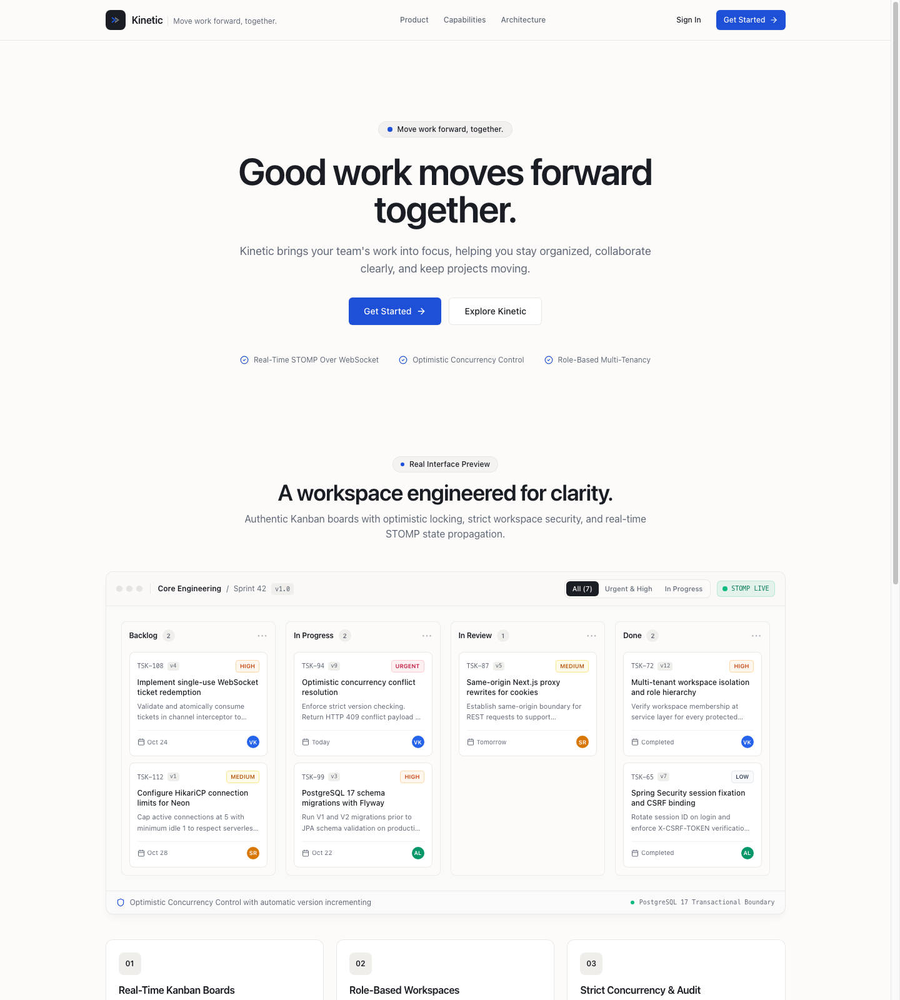
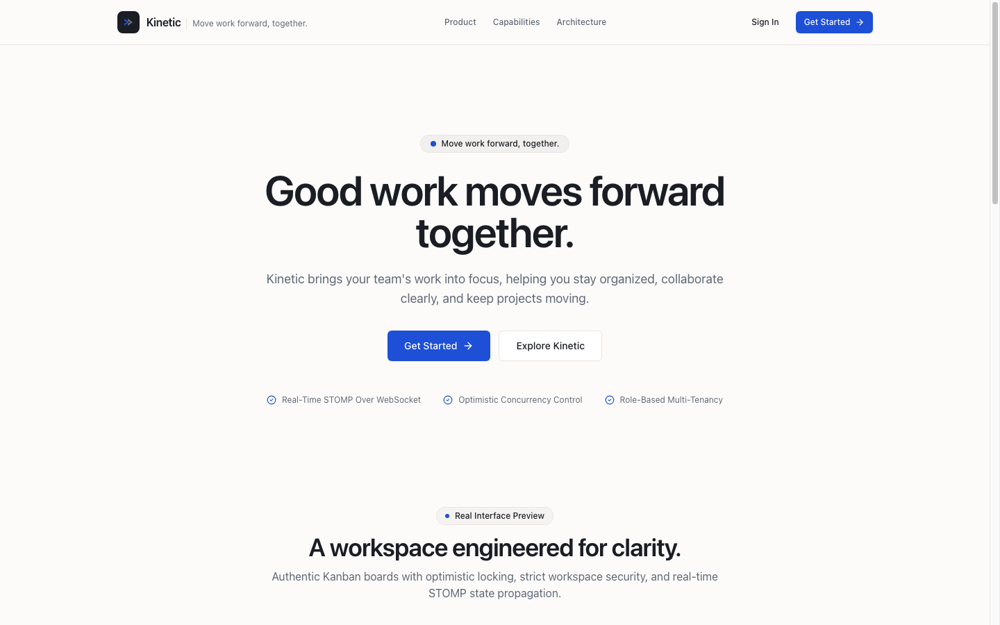
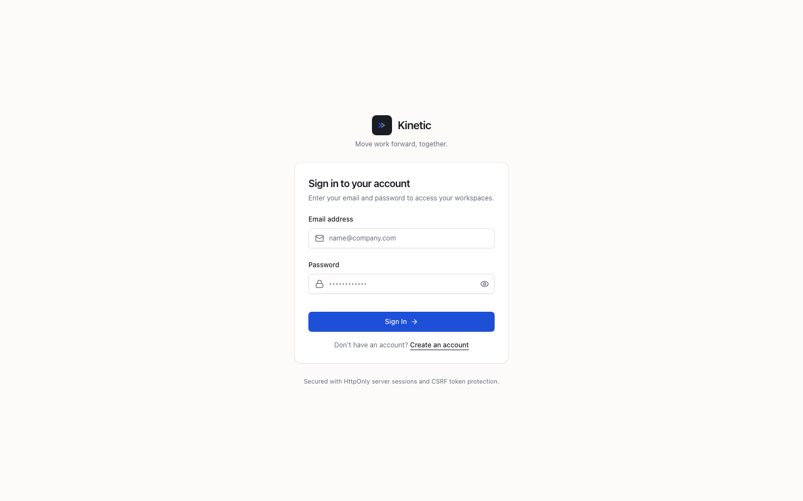
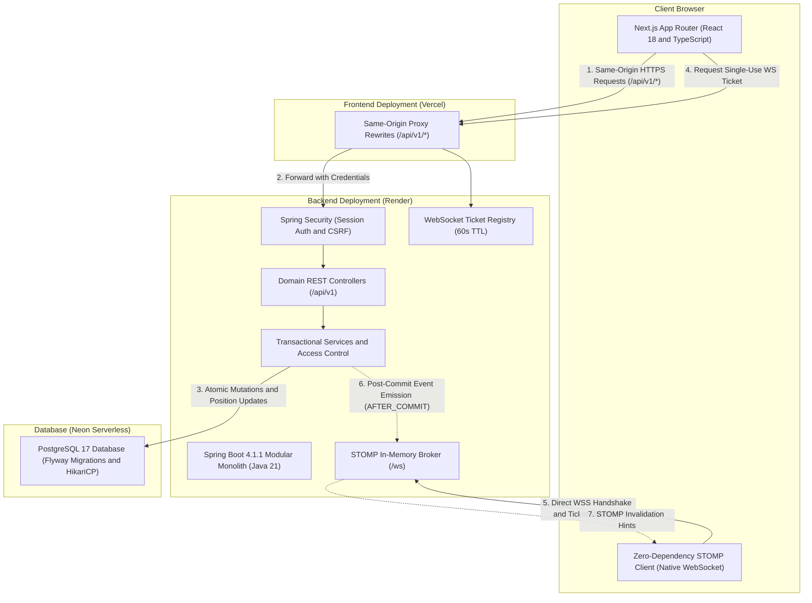

# Kinetic

> "Move work forward, together."

Kinetic is a full-stack collaborative project management platform built as a clean modular monolith. It brings engineering teams together with real-time Kanban boards, multi-tenant workspaces, role-based authorization, and optimistic concurrency control.

[](https://github.com/7r5995wx/Kinetic/actions/workflows/ci.yml)


---

### Quick Links

- **Live Application**: [https://kinetic-nu-one.vercel.app/](https://kinetic-nu-one.vercel.app/)
- **Backend Health Check**: [https://kinetic-backend-1mxe.onrender.com/api/v1/health](https://kinetic-backend-1mxe.onrender.com/api/v1/health)
- **GitHub Repository**: [https://github.com/7r5995wx/Kinetic](https://github.com/7r5995wx/Kinetic)

---

## 1. Product Tour and Interface

Authentic screenshots captured directly from the running deployment:

### Interactive Kanban Board and Product Showcase
The central collaboration canvas features real-time STOMP state propagation, optimistic concurrency version indicators (`v3`, `v8`), priority categorization, and column stages.



### Developer-Focused Landing Experience
Restrained, high-clarity landing interface built with system typography, warm neutral surfaces, and authentic product storytelling.



### Secure Authentication Surface
Session-based authentication interface with BCrypt password hashing, automatic session ID rotation, and CSRF token binding.



---

## 2. Core Features

### Identity, Session Security, and CSRF Defense
- **BCrypt Password Hashing**: Passwords hashed with BCrypt strength 12. Credentials never enter logs or API responses.
- **Session-Based Authentication**: Server-managed HTTP sessions stored in memory and rotated on login and registration to prevent session fixation attacks.
- **Synchronizer Token CSRF Protection**: Every state-changing REST call (`POST`, `PUT`, `PATCH`, `DELETE`) requires an `X-CSRF-TOKEN` header validated against the server session.
- **Secure Cookie Configuration**: Deployed session cookies enforce `HttpOnly`, `Secure`, and `SameSite=Lax`.

### Multi-Tenant Workspaces and Role-Based Access Control (RBAC)
- **Tenant Isolation**: All projects, columns, and tasks are strictly scoped to a parent workspace.
- **Role Hierarchy**: Enforces `OWNER`, `ADMIN`, and `MEMBER` roles at the service layer on every query and mutation.
- **Sole-Owner Safety Guard**: Workspaces prevent removing or demoting the last remaining owner, protecting against orphaned resources.
- **Parent-Child Hierarchy Validation**: Deep entity checks ensure columns, tasks, and projects belong to the requested workspace before mutation, preventing ID tampering.

### Kanban Board and Dense Contiguous Task Ordering
- **Automated Workflow Stages**: Creating a project automatically provisions default columns (`Backlog`, `To Do`, `In Progress`, `In Review`, `Done`).
- **Dense Contiguous Positions**: Task order within each column is maintained as contiguous integers (`0, 1, 2, ...`). Reordering executes within an atomic database transaction.
- **Accessible Keyboard Reordering**: Users can reorder tasks within columns or move them between columns via dedicated keyboard-accessible dropdown controls and position buttons.

### Optimistic Concurrency Control (Conflict Detection)
- **Zero Lost Updates**: Tasks utilize JPA `@Version` tokens. The frontend submits the task version it rendered.
- **HTTP 409 Conflict Response**: If another collaborator updated the task in the interim, the backend rejects the mutation with `409 TASK_VERSION_CONFLICT` and returns the authoritative server state.
- **Graceful Client Recovery**: The UI displays a non-blocking conflict banner and prompts the user to reload the latest state before reapplying edits.

### Real-Time Collaboration (STOMP over WebSocket)
- **Single-Use WebSocket Tickets**: Direct WebSocket connections to Render bypass third-party cookie restrictions by redeeming short-lived (60-second TTL), single-use cryptographically secure tickets obtained via the same-origin REST proxy (`POST /api/v1/auth/ws-ticket`).
- **Destination Authorization**: Inbound STOMP subscriptions (`/topic/projects/{id}`, `/topic/workspaces/{id}`) are authorized against the authenticated user's workspace membership. Client broadcasts to topics are blocked.
- **Transactional Post-Commit Emission**: Events are dispatched exclusively via `@TransactionalEventListener(phase = AFTER_COMMIT)`, guaranteeing notifications are never emitted for rolled-back transactions.
- **Zero-Dependency Resilient Client**: Native browser WebSocket client featuring automatic heartbeat monitoring, exponential backoff with jitter, and automatic REST resynchronization upon reconnect.

### Workspace Audit Activity Feed and Export
- **Persistent Activity Stream**: Records structured, immutable audit entries for task creation, updates, column moves, deletion, project creation, updates, and comments.
- **Transactional Rollback Guarantees**: Activity records are committed inside the exact business transaction boundary, guaranteeing zero orphan events for aborted or invalid operations.
- **Spreadsheet Formula Injection Defense**: CSV exports automatically neutralize executable spreadsheet triggers (`=`, `+`, `-`, `@`, `\t`, `\r`) through character prefix escaping, preventing formula injection vulnerabilities in spreadsheet software.
- **CSV & JSON Export**: Workspace members can download deterministic, workspace-scoped audit trails directly from the workspace UI.
- **Historical Record Preservation**: Audit log entries are retained even after referenced tasks or projects are deleted.

---

## 3. Technology Stack

| Category | Technologies | Purpose in Kinetic |
| :--- | :--- | :--- |
| **Frontend** | Next.js 14 (App Router), React 18, TypeScript (strict) | Server and client rendered UI, layout routing, same-origin API proxy |
| **Styling & UI** | Tailwind CSS, Radix UI Primitives, Lucide Icons | Accessible, high-contrast design system with native system fonts |
| **Backend** | Java 21 LTS, Spring Boot 4.1.1 | Modular monolith architecture, domain services, REST controllers |
| **Security** | Spring Security, BCrypt, CSRF Filter | Session lifecycle management, role authorization, ticket generation |
| **Real-Time** | Spring WebSocket, STOMP Messaging | Inbound channel interceptor, topic subscriptions, event fan-out |
| **Persistence** | PostgreSQL 17, Spring Data JPA, Hibernate 6, Flyway | Authoritative ACID relational storage, versioned schema migrations |
| **Connection Pool** | HikariCP | Connection pooling tuned for serverless PostgreSQL (`max-pool-size: 5`) |
| **Testing** | Vitest, React Testing Library, JUnit 5, Testcontainers | Unit, integration, security, and concurrency regression tests |
| **Hosting & CI** | Vercel, Render, Neon, GitHub Actions | Edge hosting, containerized backend, serverless database, CI pipeline |

---

## 4. System Architecture

Kinetic is built as a modular monolith: a single deployable Next.js frontend and a single deployable Spring Boot backend backed by Neon PostgreSQL.

### Architecture Diagram



### Architectural Decisions

1. **Why a Modular Monolith?**  
   Avoids distributed transaction complexity, network latency, and operational overhead. Domain modules (`identity`, `workspace`, `project`, `task`, `realtime`) communicate through Java service interfaces within the same process.
2. **Why a Same-Origin REST Proxy?**  
   Modern browsers (Safari ITP, Firefox ETP, Chrome Privacy Sandbox) block cross-site third-party cookies by default. In production, Vercel rewrites `/api/v1/*` directly to Render, allowing session cookies to use `SameSite=Lax; Secure; HttpOnly`.
3. **Why Single-Use WebSocket Tickets?**  
   Because WebSockets connect directly to Render (`wss://.../ws`) to maintain long-lived duplex connections, browser cookies would be treated as cross-site during the handshake. The frontend acquires a 60-second single-use ticket via the same-origin REST API and passes it in the STOMP `CONNECT` frame, where it is validated and immediately purged.
4. **Why Flyway Migrations?**  
   Hibernate `ddl-auto` is disabled in production. Flyway executes versioned SQL migrations (`V1__create_users.sql`, `V2__create_workspace_project_and_task_tables.sql`) deterministically on application startup before JPA validation runs.

---

## 5. Local Development Setup

### Prerequisites
- **Java**: OpenJDK 21 LTS (`java -version`)
- **Maven**: Provided via `./mvnw` inside `backend/`
- **Node.js**: Node.js 20 LTS or higher (`node -v`)
- **npm**: npm 10+ (`npm -v`)
- **Docker**: Docker Desktop (optional, for local PostgreSQL container)

### Step 1: Clone Repository
```bash
git clone https://github.com/7r5995wx/Kinetic.git
cd Kinetic
```

### Step 2: Database Setup
You can run a local PostgreSQL instance via Docker Compose or use an external PostgreSQL database:
```bash
# Start local PostgreSQL 17 container
docker compose -f backend/compose.yaml up -d postgres
```
*(Note: If Docker is unavailable, the backend automated test suite runs against an embedded H2 database in PostgreSQL compatibility mode).*

### Step 3: Backend Startup
```bash
# Navigate to backend directory
cd backend

# Create local environment file from template
cp .env.example .env

# Start Spring Boot backend
./mvnw spring-boot:run
```
Verify the backend is healthy:
- Application Health: `http://localhost:8080/api/v1/health`
- Actuator Health: `http://localhost:8080/actuator/health`

### Step 4: Frontend Startup
In a separate terminal:
```bash
# Navigate to frontend directory
cd frontend

# Install dependencies reproducibly
npm ci

# Create local environment configuration
cp .env.example .env.local

# Start Next.js development server
npm run dev
```
Open [http://localhost:3000](http://localhost:3000) in your browser.

---

## 6. Environment Variables Reference

| Variable | Scope | Default (Local) | Production Example | Description |
| :--- | :--- | :--- | :--- | :--- |
| `BACKEND_API_INTERNAL_URL` | Frontend | *(optional)* | `https://kinetic-backend-1mxe.onrender.com` | Target backend URL for Next.js same-origin rewrite proxy |
| `NEXT_PUBLIC_BACKEND_URL` | Frontend | `http://localhost:8080` | `https://kinetic-backend-1mxe.onrender.com` | Fallback backend origin |
| `NEXT_PUBLIC_WS_URL` | Frontend | `ws://localhost:8080/ws` | `wss://kinetic-backend-1mxe.onrender.com/ws` | Direct STOMP WebSocket endpoint |
| `DATABASE_URL` | Backend | `jdbc:postgresql://localhost:5432/kinetic` | `jdbc:postgresql://<neon-host>/<db>?sslmode=require` | PostgreSQL JDBC connection URL |
| `DATABASE_USERNAME` | Backend | `kinetic` | `<neon-username>` | Database username |
| `DATABASE_PASSWORD` | Backend | *(local secret)* | *(provider secret)* | Database password |
| `ALLOWED_ORIGINS` | Backend | `http://localhost:3000` | `https://kinetic-nu-one.vercel.app` | Allowed CORS and WebSocket handshake origin |
| `SESSION_COOKIE_SECURE` | Backend | `false` | `true` | Restricts cookies to HTTPS |
| `SESSION_COOKIE_SAME_SITE` | Backend | `lax` | `lax` | SameSite cookie policy |
| `SESSION_TIMEOUT` | Backend | `8h` | `8h` | Server session expiration |

---

## 7. Deployment Architecture and Status

Kinetic is deployed on cloud infrastructure using provider-managed environments:

- **Frontend**: [Vercel](https://kinetic-nu-one.vercel.app/) (Next.js App Router, global edge CDN, and same-origin proxy rewrites).
- **Backend**: [Render](https://kinetic-backend-1mxe.onrender.com/api/v1/health) (Multi-stage Docker container with Temurin 21 JRE, running as a non-root user).
- **Database**: [Neon](https://neon.tech/) (Serverless PostgreSQL 17 with SSL connection pooling).

### Verification Matrix

| Verification Aspect | Status | Details |
| :--- | :--- | :--- |
| **Frontend Deployment** | Confirmed Live | Accessible at `https://kinetic-nu-one.vercel.app/` |
| **Backend Liveness** | Confirmed Live | Health check returns HTTP 200 `{"status":"UP"}` |
| **Same-Origin API Proxy** | Confirmed Live | `https://kinetic-nu-one.vercel.app/api/v1/health` routes to Render |
| **Database Migrations** | Confirmed Live | Flyway V1 and V2 applied automatically on startup |
| **Continuous Integration** | Passing | GitHub Actions runs full backend and frontend validation on push |
| **Production Workflows** | Verified | Registration, session auth, board rendering, and real-time STOMP |

### Operational Notes
- **Render Free-Tier Spin-Down**: Render automatically spins down free web services after 15 minutes of inactivity. When a request arrives, cold-start initialization takes approximately 50 to 60 seconds. The frontend STOMP client gracefully detects disconnects, displays a subtle `Reconnecting...` badge, and automatically resynchronizes via REST upon reconnection.
- **Neon Connection Limits**: HikariCP is capped at `maximum-pool-size: 5` with `minimum-idle: 1` to prevent exhausting connection limits on serverless database tiers.

---

## 8. Testing and Quality Assurance

The codebase enforces strict test coverage across frontend and backend layers:

### Backend Testing (JUnit 5 & Spring Boot Test)
- **79 tests passing** (0 failures, 0 errors).
- Covers REST API contracts, service-level authorization, sole-owner safety logic, Flyway migrations, and STOMP security interceptors.
- CI executes all tests against a dedicated PostgreSQL 17 container using Testcontainers.

```bash
cd backend
# Run full backend test suite
./mvnw test

# Package production executable JAR
./mvnw package -DskipTests
```

### Frontend Testing (Vitest & React Testing Library)
- **71 tests passing** across 19 test suites (0 failures).
- Covers authentication flows, registration validation, board manipulation, optimistic concurrency conflict handling, STOMP reconnect logic, safe Markdown rendering, task comments, workspace activity stream, and UI components.
- Zero TypeScript compiler errors (`tsc --noEmit`).
- Zero ESLint errors or warnings (`next lint`).

```bash
cd frontend
# Run Vitest test suite
npm test

# Run TypeScript type check
npm run typecheck

# Run ESLint check
npm run lint

# Build production artifact
npm run build
```

### Continuous Integration Pipeline (`.github/workflows/ci.yml`)
Every commit and pull request to `main` triggers automated GitHub Actions jobs:
1. **Backend CI**: Sets up Java 21 Temurin, spins up a live `postgres:17-alpine` service container, executes `./mvnw test`, and builds the Spring Boot executable JAR.
2. **Frontend CI**: Sets up Node.js 20 LTS, performs clean dependency installation via `npm ci`, checks linting, runs `tsc --noEmit`, executes Vitest, and compiles the Next.js production build.

---

## 9. Known Limitations and Trade-offs

- **Single-Instance WebSocket Broker**: The current STOMP implementation uses Spring's built-in in-memory broker and a local `ConcurrentHashMap` ticket registry. This design is optimal for a modular monolith on a single Render instance. Scaling out horizontally across multiple instances would require backing the ticket registry with Redis (`GETDEL`) and relaying messages via RabbitMQ or Redis Pub/Sub.
- **Render Free Spin-Down**: The backend sleeps after 15 minutes of idle time. The application is resilient to this behavior through automatic reconnect logic, but first requests after inactivity experience a cold-start delay.
- **Contiguous Numeric Ordering**: Task positions are integers rebalanced within a single database transaction. This approach is straightforward and robust for small-to-medium project teams. For massive boards with high concurrent reordering volume, fractional indexing (lexorank) can be evaluated.

---

## 10. Roadmap

### Completed Milestones
- [x] Multi-tenant workspace and project management
- [x] Real-time STOMP Kanban board synchronization
- [x] Optimistic locking with automatic conflict resolution prompts
- [x] Same-origin Next.js proxy for strict cookie privacy compliance
- [x] Task comments with safe Markdown preview and real-time thread synchronization
- [x] Workspace audit activity stream and export (CSV & JSON)

### Planned Engineering Milestones
- [ ] Redis-backed STOMP relay for multi-instance horizontal scaling
- [ ] Custom user avatars and workspace branding customization

---

## 11. Contributing and License

Contributions, issues, and feature requests are welcome. Feel free to inspect the [open issues](https://github.com/7r5995wx/Kinetic/issues) or submit a pull request.

When contributing:
1. Fork the repository and create a descriptive feature branch.
2. Ensure all backend tests (`./mvnw test`) and frontend checks (`npm test`, `npm run typecheck`, `npm run lint`, `npm run build`) pass.
3. Submit a pull request referencing the relevant issue.

*Note: A formal open-source license has not yet been designated for this repository.*
